# СВОЁ СтройКонтроль

«СВОЁ СтройКонтроль» помогает заказчику и подрядчику договориться о строительстве загородного дома и следить за выполнением работ. Заказчик описывает дом, участок, бюджет и желаемые сроки. Подрядчик предлагает смету и график, затем договор подряда. После согласования договора обе стороны видят общий план и фактический ход строительства.

## Начните с карточки дома

Заказчик создаёт карточку с названием дома и адресом участка. В ней собраны подрядчик, подготовка документов, рабочий план и итог строительства.

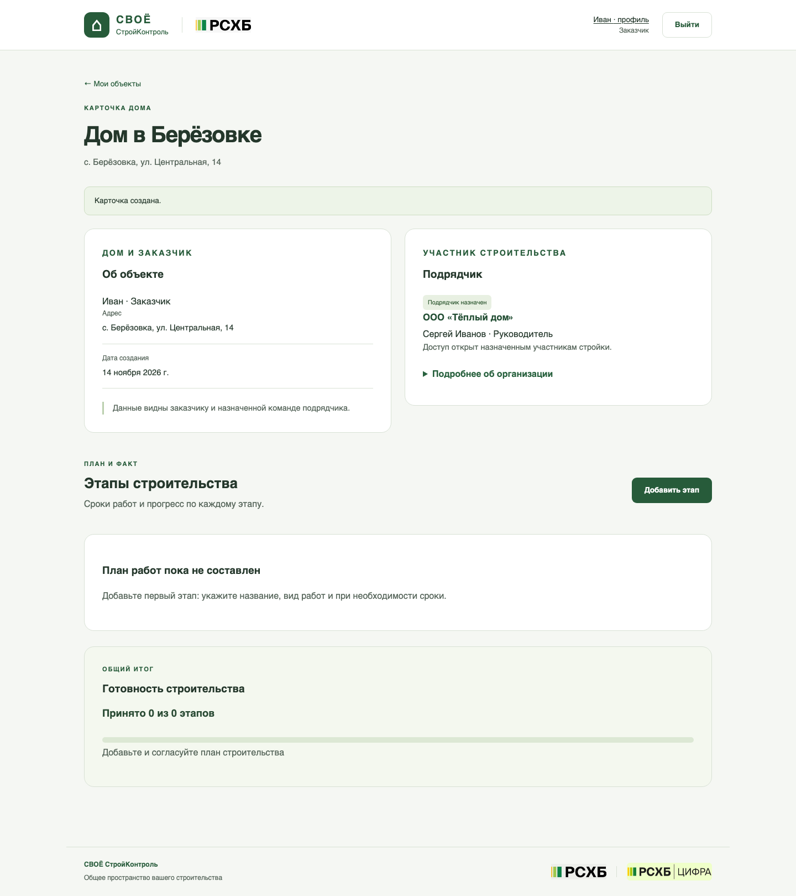

<details>
<summary>Вход, создание карточки, назначение подрядчика и мобильный вид</summary>

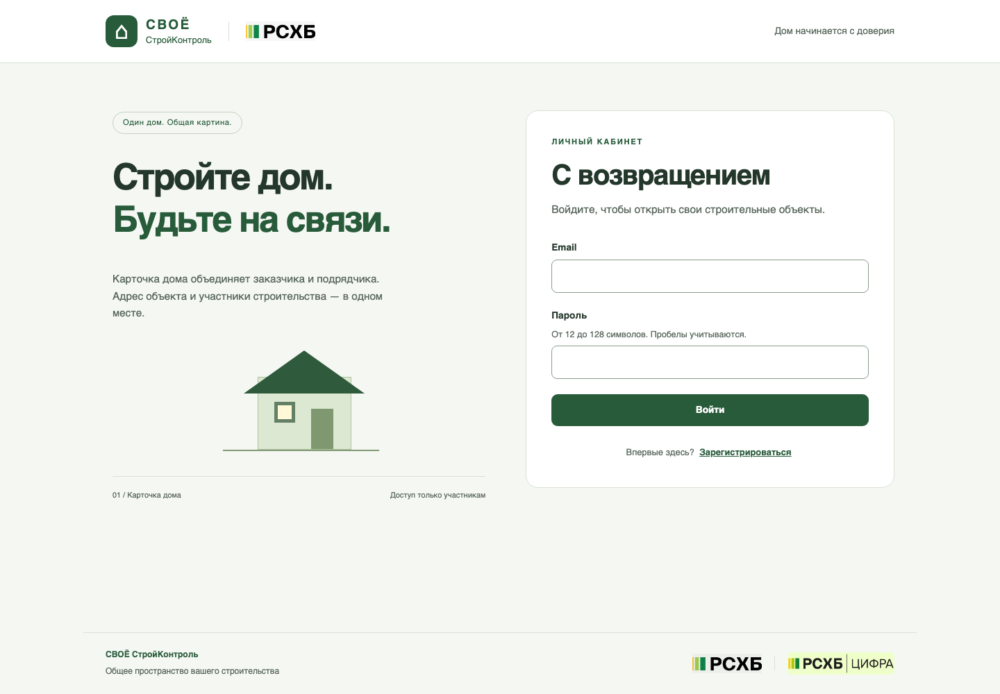

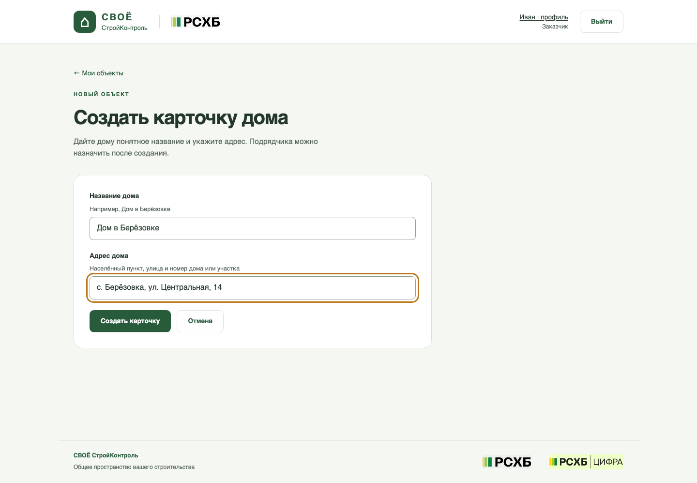

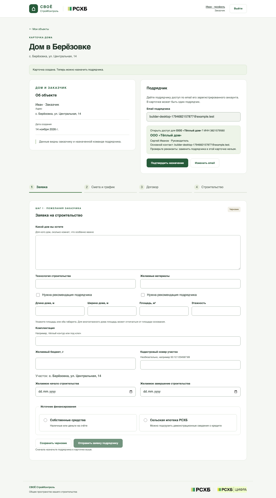

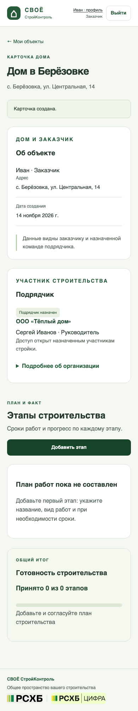

</details>

## Опишите будущий дом

Зарегистрируйтесь как **Заказчик**, войдите и нажмите **Создать карточку** в разделе **Мои объекты**. Укажите название дома и местоположение участка. В **Заявке на строительство** опишите дом, технологию и материалы, площадь или габариты, этажность, комплектацию, бюджет и желаемые даты. Кадастровый номер необязателен; вместо выбора технологии и материалов можно запросить рекомендацию подрядчика.

Незавершённую заявку можно сохранить кнопкой **Сохранить черновик**. В карточке **Подрядчик** укажите email руководителя зарегистрированной организации, проверьте название и ИНН, подтвердите назначение и нажмите **Отправить заявку подрядчику**. Только после отправки подрядчик получает доступ к новому объекту.

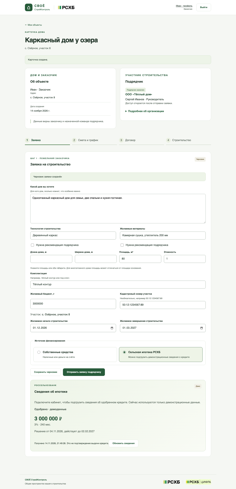

<details>
<summary>Заявка на телефоне</summary>

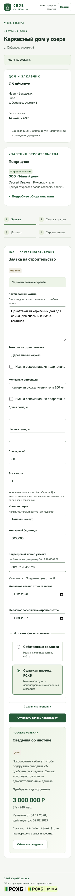

</details>

## Работайте с организацией и командой

Подрядчик указывает имя и фамилию и открывает **Мой профиль**. Руководитель создаёт организацию или ИП: название, полное наименование, ИНН и адрес; телефон необязателен. Проверка формата ИНН не означает проверку компании по реестрам. В карточке дома сразу видны название и основной контакт, реквизиты раскрываются через **Подробнее об организации**.

Руководитель приглашает уже зарегистрированных сотрудников по email, сотрудники принимают приглашения в своём профиле. Письма не отправляются. Через **Настроить команду стройки** руководитель выдаёт два независимых доступа: **Документы** — смета и договор, **Работы** — этапы и журнал. Членство в компании не открывает все её стройки. Заказчик видит команду своего дома.

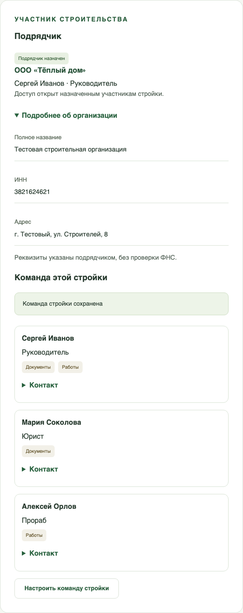

В документах и обсуждениях видны имя сотрудника и должность, в ответах заказчика — его имя. История сохраняет подпись на момент действия, даже если профиль изменился. Отзыв доступа действует и в уже открытой сессии.

<details>
<summary>Профиль организации, персональное авторство и команда на телефоне</summary>

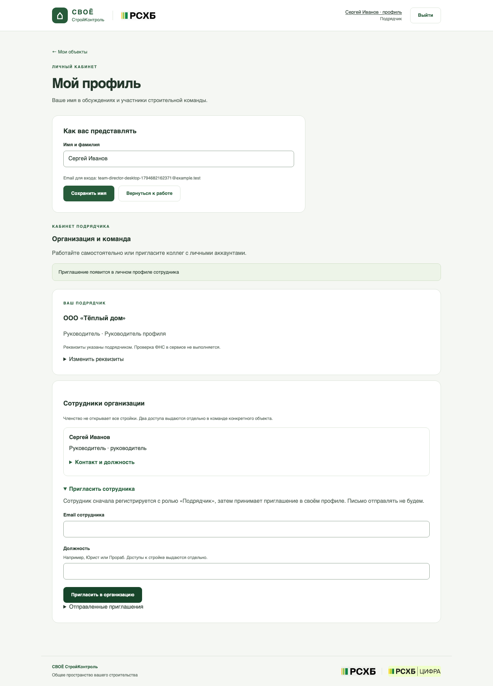

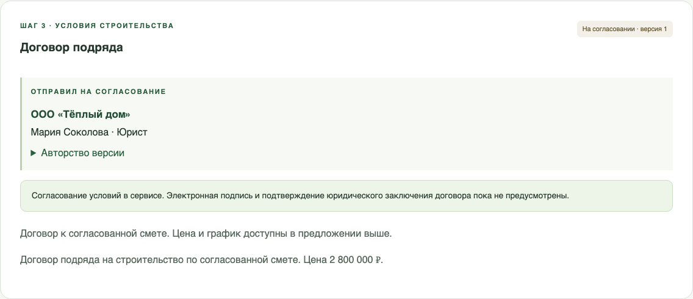

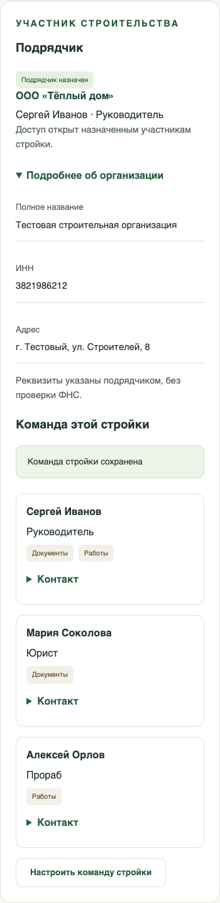

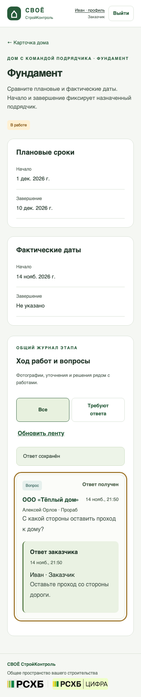

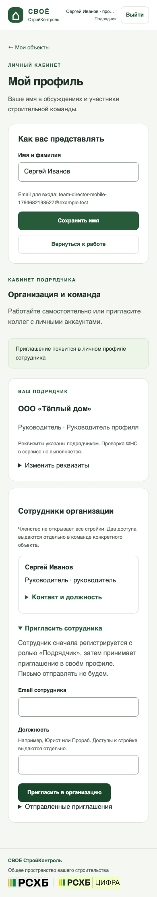

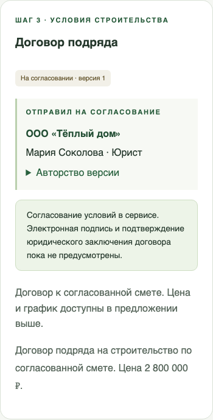

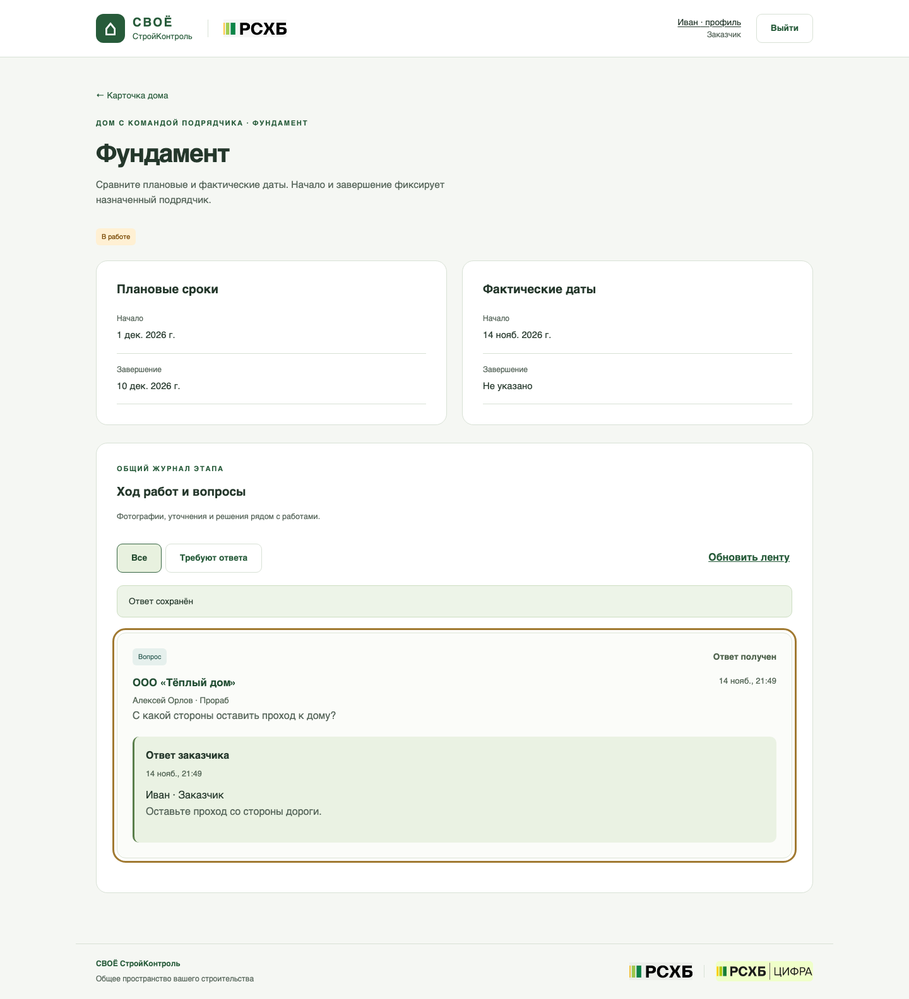

</details>

## Согласуйте смету и график

Подрядчик открывает полученную заявку, нажимает **Подготовить предложение**, описывает работы, материалы и цены текстом, задаёт общую стоимость и этапы со сроками. Можно добавить картинки по HTTPS-ссылкам с подписями. Итог вводится вручную — сервис не вычисляет его из текста сметы.

После **Сохранить предложение** подрядчик нажимает **Отправить предложение на согласование**. Заказчик сравнивает цену и сроки с пожеланиями и выбирает **Согласовать предложение** либо **Вернуть на уточнение** с замечанием. Каждая отправленная версия сохраняется в истории.

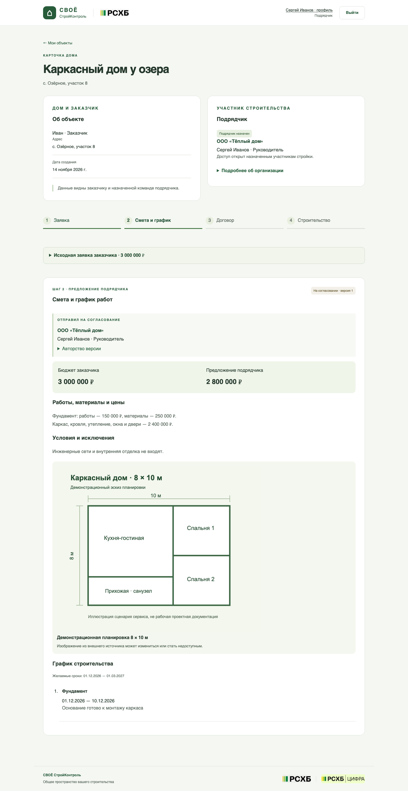

<details>
<summary>Предложение на телефоне</summary>

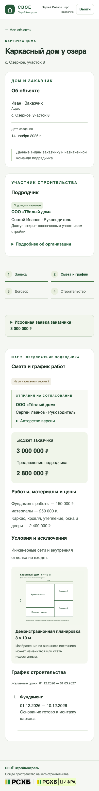

</details>

## Согласуйте договор перед началом работ

После согласования сметы подрядчик нажимает **Подготовить договор**, заполняет текст договора подряда, сохраняет его и подтверждает **Условия проверены, отправить заказчику**. Заказчик согласует договор или возвращает его с замечаниями. Подрядчик может подготовить следующую версию, сохранив предыдущую и решение по ней.

Смета и план после согласования доступны только для чтения. Этапы появляются в рабочем плане после согласования сметы, а **начать работы можно после согласования договора**. Сервис фиксирует внутреннее согласование условий; электронной подписи и подтверждения юридического заключения договора пока нет.

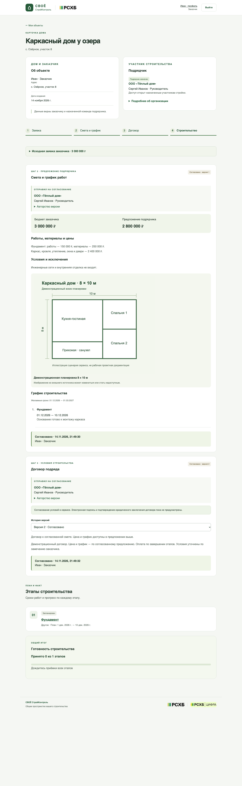

<details>
<summary>Договор и рабочий план на телефоне</summary>

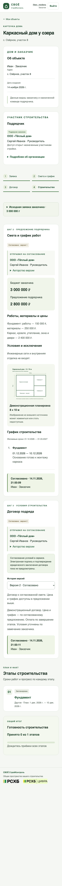

</details>

## Следите за выполнением

Подрядчик открывает этап и нажимает **Начать работы**, затем **Завершить работы**. Фактические даты фиксируются по московскому времени. Обе стороны видят план, факт и просрочки. Статус **Работы завершены** означает отметку подрядчика. Приёмка заказчиком выполняется отдельно, с подтверждениями и сохранением истории.

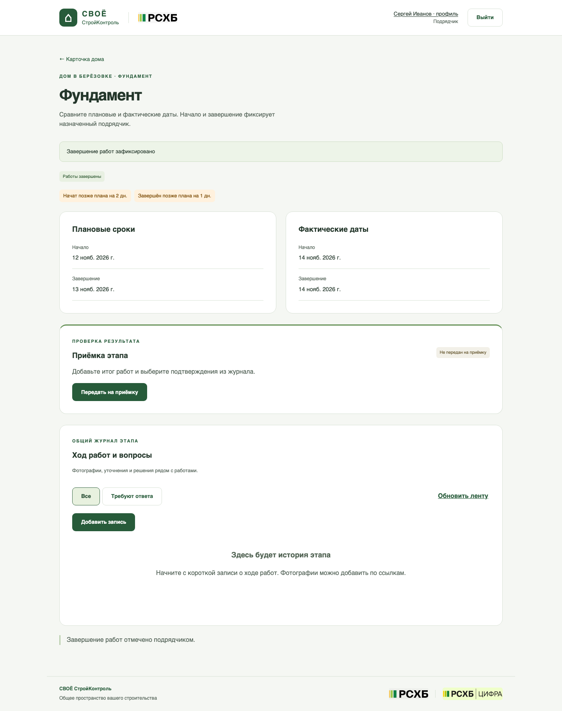

<details>
<summary>Общий план и выполнение на телефоне</summary>

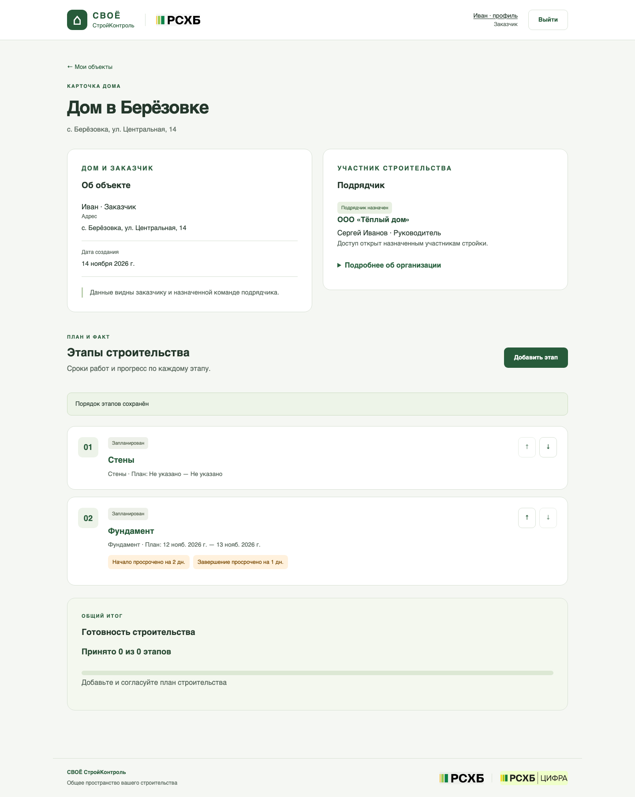

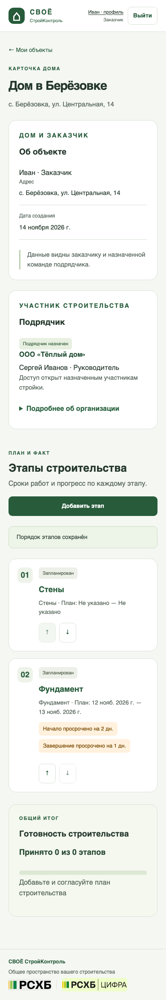

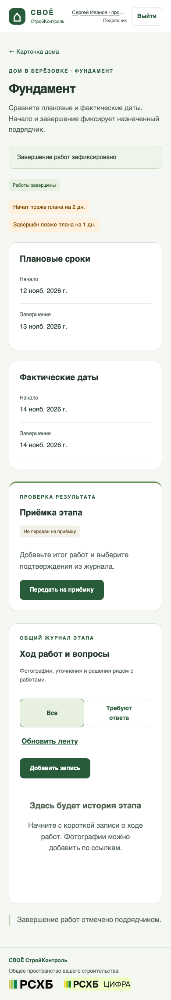

</details>

В проектах, созданных до нового процесса подготовки, сохранены прежние этапы и возможность заказчика редактировать план. Новые карточки проходят заявку, смету и договор. История существующих работ не сбрасывается.

## Обсуждайте ход работ в этапе

В открытом этапе подрядчик нажимает **Добавить запись** и выбирает **Ход работ**, **Вопрос** или **На согласование**. К тексту можно добавить закрытые фотографии с подписями и PDF с устройства через **Добавить фото или PDF**. Для фото доступен предпросмотр, документ скачивается участниками стройки. Сохраняется и прежняя возможность добавить HTTPS-ссылку как иллюстрацию. Заказчик отвечает прямо под вопросом либо выбирает **Согласовать / Не согласовать**; отказ требует пояснения. Фильтр **Требуют ответа** помогает найти незавершённые обсуждения. Ответить на ранее заданный вопрос можно и после завершения работ этапа, пока заказчик не подтвердил завершение всего строительства.

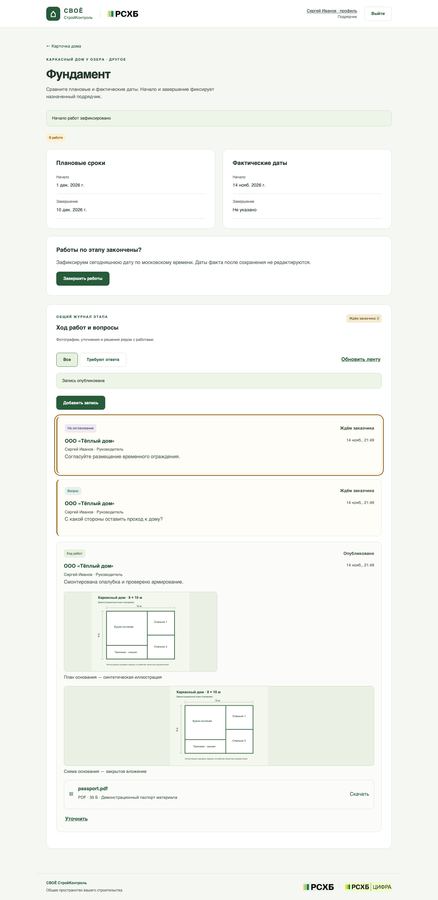

<details>
<summary>Ответы заказчика и мобильный вид</summary>

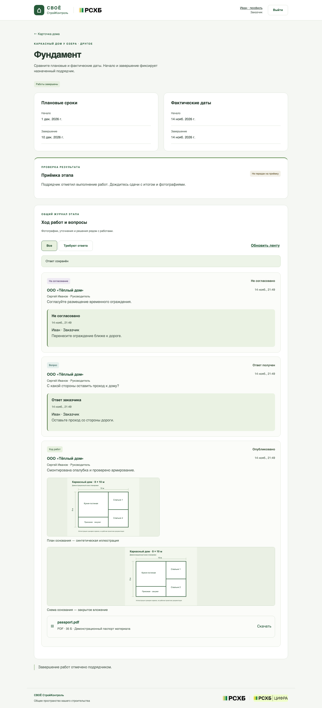

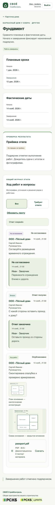

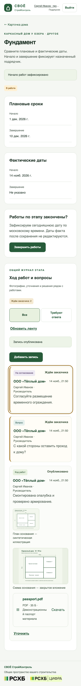

</details>

Решение по записи не меняет согласованные стоимость, график и договор. Загруженные файлы доступны только участникам конкретной стройки. Фотографии — JPEG, PNG или WebP до 10 МиБ; документы — PDF до 20 МиБ; до 10 файлов на запись. При ошибке загрузки текст и выбранные файлы остаются в форме для повтора.

## Примите этап с подтверждениями

После завершения работ сотрудник с доступом **Работы** нажимает **Передать на приёмку**, кратко описывает результат и выбирает записи журнала с загруженными фотографиями. Заказчик проверяет подтверждения и нажимает **Принять этап** либо **Вернуть с замечаниями**. Подрядчик добавляет исправления и сдаёт этап повторно. История решений, авторы и исходные даты выполнения сохраняются.

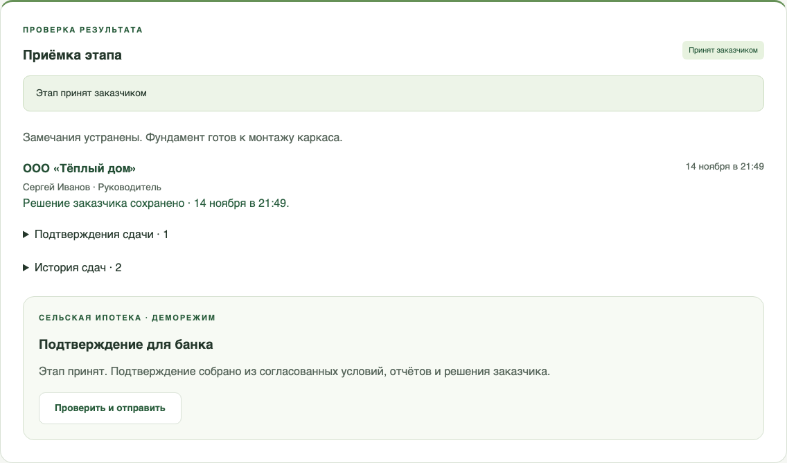

<details>
<summary>Замечания и приёмка на телефоне</summary>

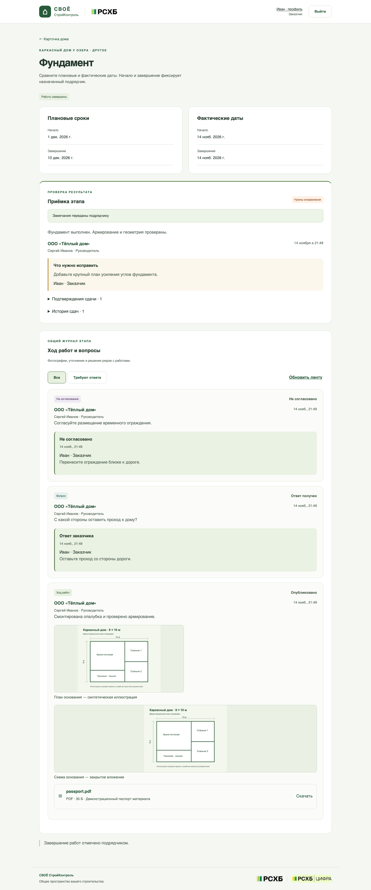

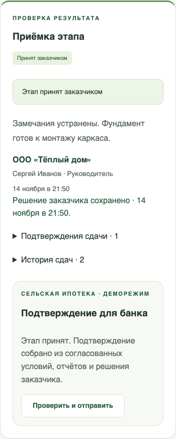

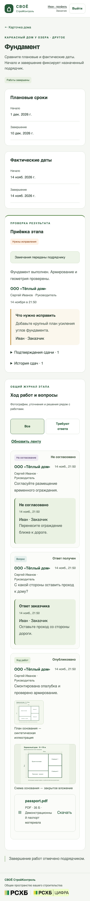

</details>

## Передайте подтверждение в демо-банк

При **Сельской ипотеке РСХБ** заказчик видит отдельный блок **Подтверждение для банка**. Кнопка **Проверить и отправить** открывает состав пакета: дом, согласованные документы, этап и принятые подтверждения. Отправка выполняется только после явного подтверждения заказчиком. Если кредитное дело ещё не подключено, можно подключить отдельное синтетическое дело с согласием — исходная заявка не меняется.

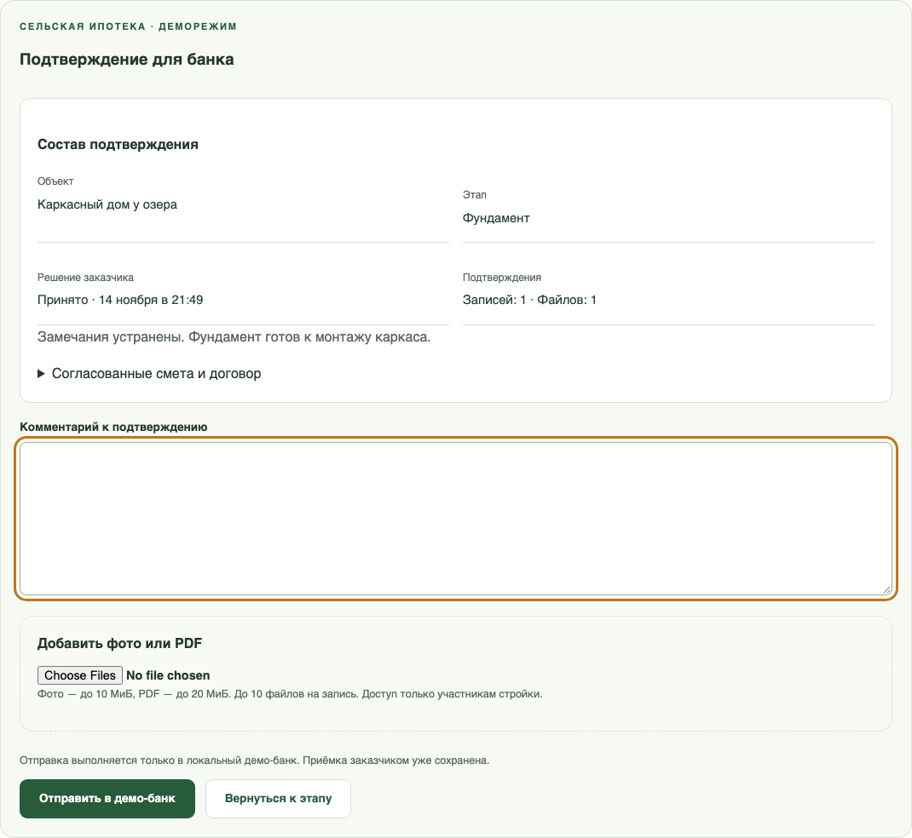

**Получено** и **Принято демо-банком** — разные состояния. При **Нужно дополнить** заказчик прикладывает пояснение или новые файлы и отправляет следующую версию. История пакетов и попыток сохраняется; повтор после сбоя не создаёт повторную отправку. Подрядчик видит статус, но не кредитные сведения и закрытые банковские документы. При собственных средствах этого блока нет.

<details>
<summary>Запрос дополнения</summary>

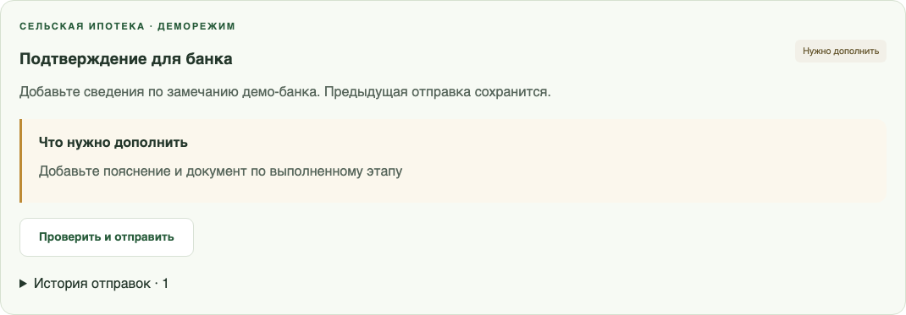

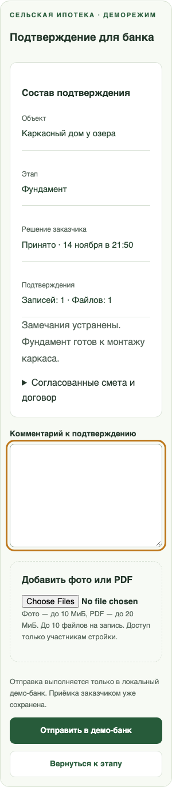

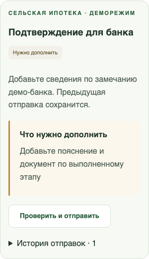

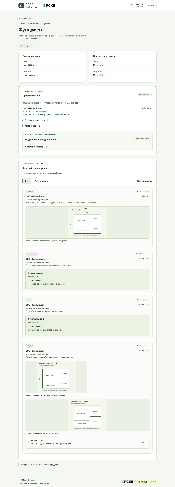

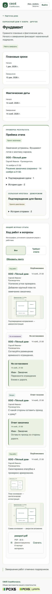

</details>

## Подтвердите завершение строительства

Когда приняты все этапы непустого плана, заказчик нажимает **Подтвердить завершение строительства** и подтверждает решение. Сохраняются дата и имя заказчика; этапы и журнал становятся историей для чтения. Результат банковской проверки не блокирует завершение. Дополнить или повторить банковскую отправку можно и после него.

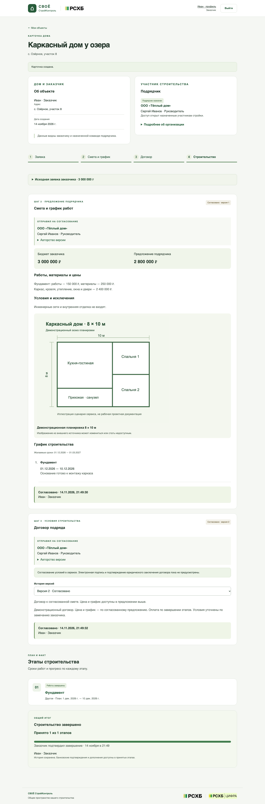

<details>
<summary>Завершённое строительство на телефоне</summary>

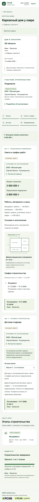

</details>

## Обратитесь к другому подрядчику

До согласования сметы заказчик может нажать **Отклонить предложение**, указать **Причину отказа** и подтвердить решение. Затем в блоке **Другой подрядчик** укажите email другого зарегистрированного исполнителя и нажмите **Создать копию заявки**. Проверьте пожелания и отправьте её отдельно. Старые документы и история остаются в исходной карточке; новый подрядчик их не видит.

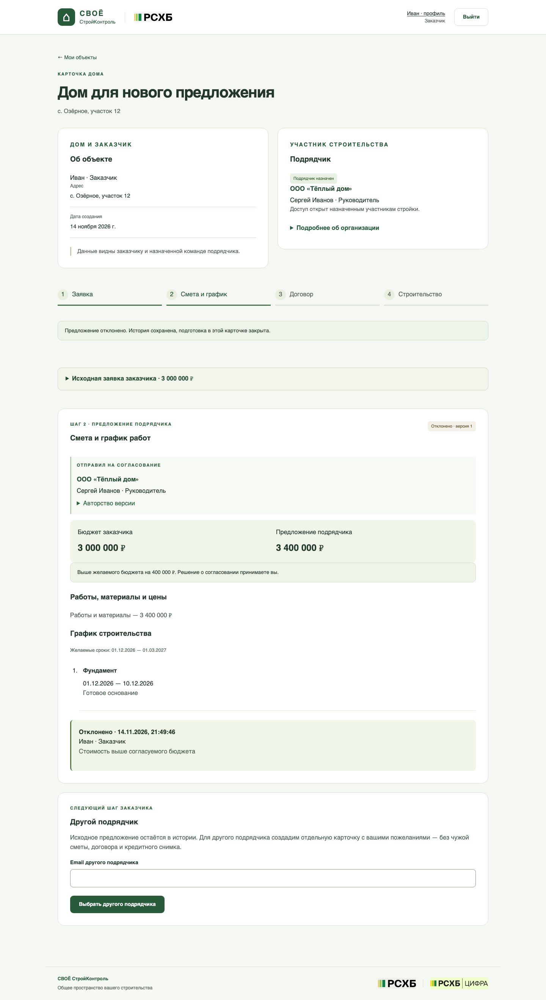

<details>
<summary>Отказ и отдельный черновик другому подрядчику</summary>

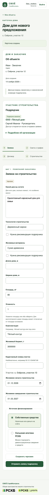

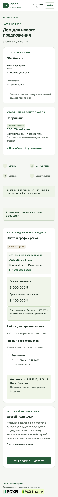

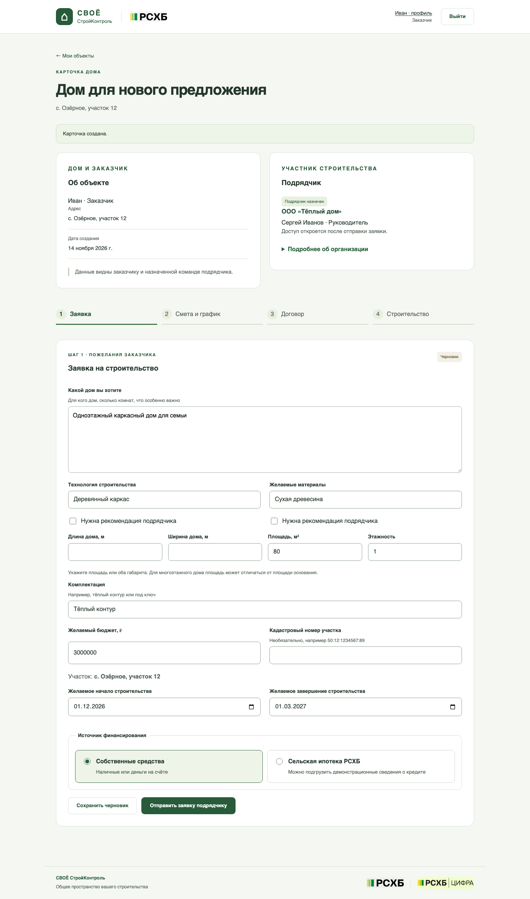

</details>

## Выберите финансирование

В заявке доступны **Собственные средства** и **Сельская ипотека РСХБ**. При ипотеке кнопка **Подключить Интернет-банк РСХБ** открывает демонстрационный сценарий получения сведений об одобренном кредите. Банковские логин, пароль и SMS-код не нужны. Сумма, ставка, срок и решение — синтетические демоданные, не реальное одобрение и не подтверждение выдачи денег. Подробности видит только заказчик; подрядчик видит выбранный источник финансирования. Подгрузка необязательна для отправки строительной заявки.

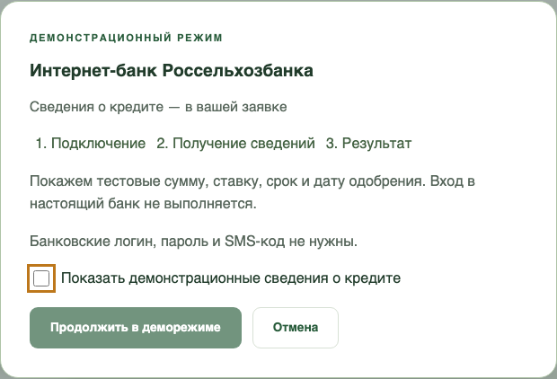

<details>
<summary>Подключение демо-кабинета</summary>

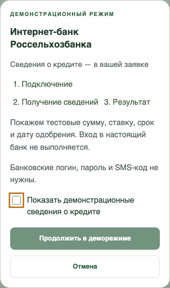

</details>

Иллюстрации сметы пока задаются HTTPS-ссылками; их оригиналы сервис не сохраняет. В журнале и банковском дополнении уже доступна закрытая загрузка фотографий и PDF с устройства.

## Запуск

```sh
docker compose up --build -d --wait
```

Откройте http://localhost:8088. Перед первым запуском задайте параметры хранилища по [инструкции](docs/development.md). Предустановленных аккаунтов нет; зарегистрируйте собственные синтетические аккаунты заказчика и подрядчика. Карточки, документы и этапы изолированы от посторонних пользователей.

[Запуск и диагностика](docs/development.md) · [Проверки](docs/testing.md) · [Демонстрация по ролям](docs/demo.md) · [Наблюдения по интерфейсу](docs/ui-acceptance.md)

## Что дальше

Минимальный MVP охватывает путь от заявки до приёмки и подтверждения завершения, включая закрытые вложения и локальный демо-банк. Личные расходы и оплаты, напоминания по ипотеке и помощник при приёмке остаются отдельными расширениями. [План следующих этапов](docs/roadmap.md).

[Архитектура](docs/architecture.md) · [Версии стека](docs/versions.md) · [OpenAPI](api/openapi.yaml)
