# Демонстрация: от заявки до выполнения этапа

Запустите приложение по [инструкции](development.md), откройте http://localhost:8088. Все данные ниже синтетические. Предустановленных пользователей нет; для повторного прохода добавьте уникальный суффикс в email.

| Роль | Email | Пароль локального демо |
|---|---|---|
| Заказчик | owner@example.test | example-password-123 |
| Подрядчик | builder@example.test | example-password-123 |
| Посторонний заказчик | other@example.test | example-password-123 |

## Участок и предварительный расчёт ипотеки

Заказчик проверяет участок своего дома и оценивает ипотечный платёж до отправки заявки подрядчику. Для демонстрации создайте новую карточку: так вы не измените уже отправленные сведения. Все приведённые номера участков и банковские условия — тестовые.

### Откройте карточку дома

Войдите заказчиком и в **Моих объектах** создайте **Дом в Сокурах**, адрес **Тестовый участок в селе Сокуры**. В подготовке строительства откройте **Участок и ипотека**. Здесь появятся результаты проверки и сохранённый расчёт, доступные только вам.

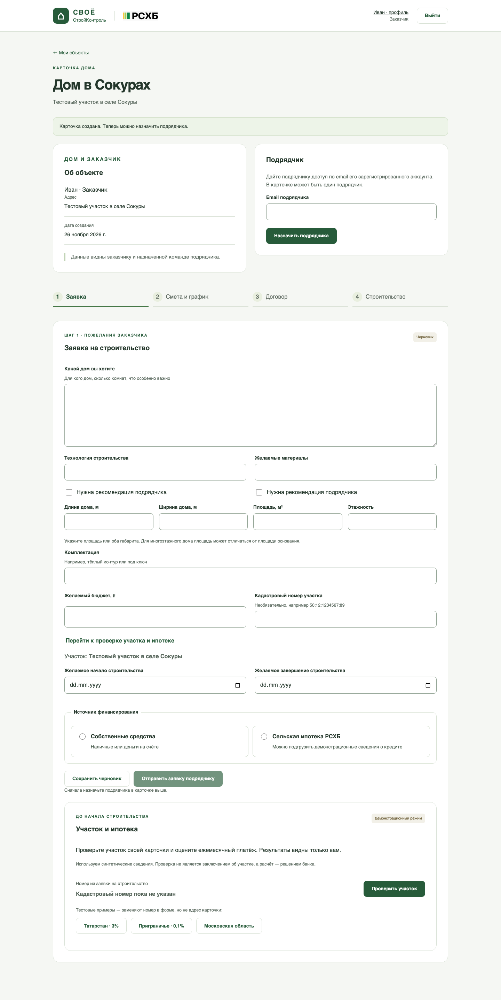

### Проверьте участок

В поле **Кадастровый номер участка** укажите `16:24:070801:412`. Нажмите **Сохранить черновик для проверки**, затем **Проверить участок**. Появятся сведения тестового участка в Татарстане, статус **Подходит по демопроверке** и ставка 3%.

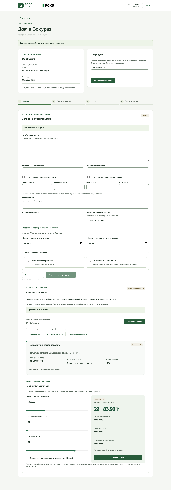

### Рассчитайте и сохраните платёж

В блоке **Рассчитайте платёж** задайте стоимость дома и участка **5 000 000 ₽**, первоначальный взнос **20%**, срок **20 лет**. Совместное оформление оставьте выключенным. Вы увидите взнос **1 000 000 ₽**, кредит **4 000 000 ₽** и предварительный платёж **22 183,90 ₽ в месяц**.

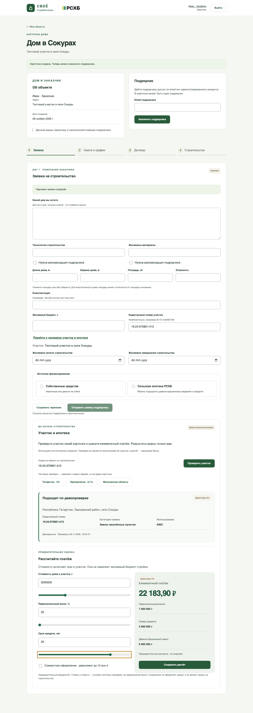

Нажмите **Сохранить расчёт** и перезагрузите страницу. В **Сохранённом предварительном расчёте** останутся выбранные параметры, точный платёж и дата сохранения. Сведения также сохраняются после выхода и повторного входа. Сохранение не оформляет кредит и не меняет бюджет или источник финансирования строительной заявки.

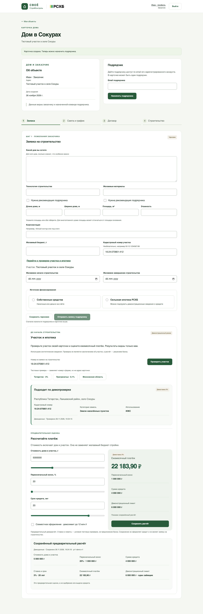

Превышение лимита и совместное оформление

Задайте стоимость **10 000 000 ₽** при взносе **20%**. Кредит **8 000 000 ₽** превышает одиночный демонстрационный лимит **6 000 000 ₽** на **2 000 000 ₽**. Можно уменьшить стоимость или увеличить взнос. Включите **Совместное оформление**: при тестовом лимите **12 000 000 ₽** предупреждение исчезнет.

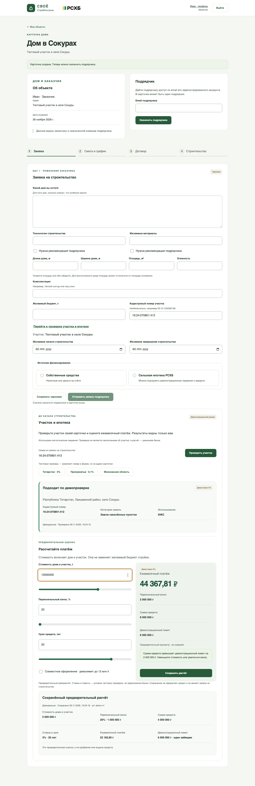

Смена номера, отрицательный результат и отсутствие данных

Замените номер в заявке на `50:21:0040112:105` и сохраните черновик. До новой проверки система предупредит, что прежние проверка и расчёт относятся к другому номеру.

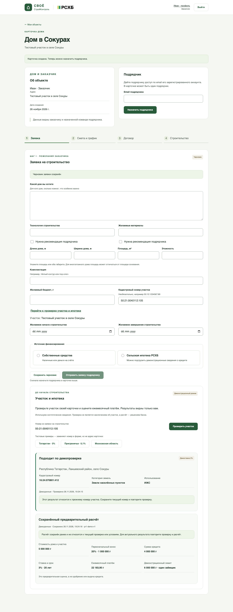

Нажмите **Проверить участок**. Появятся **Не подходит по демопроверке** и причина из тестового сценария; калькулятор сельской ипотеки для этого результата недоступен. Это не мешает продолжить заявку на строительство.

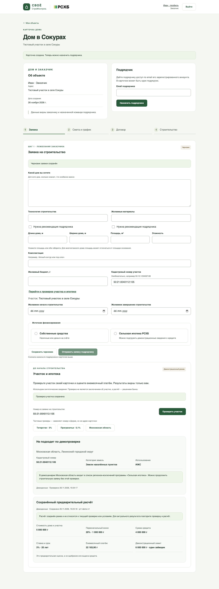

Сохраните номер `16:24:070801:999` и проверьте его. Вы увидите **Участок отсутствует в демобазе**. Отсутствие тестовых сведений не означает непригодность участка.

На полном снимке ниже результат находится в нижней части страницы: в блоке **Участок и ипотека**, под кнопками тестовых примеров и перед сохранённым расчётом. Откройте изображение в полном размере, чтобы прочитать сообщение.

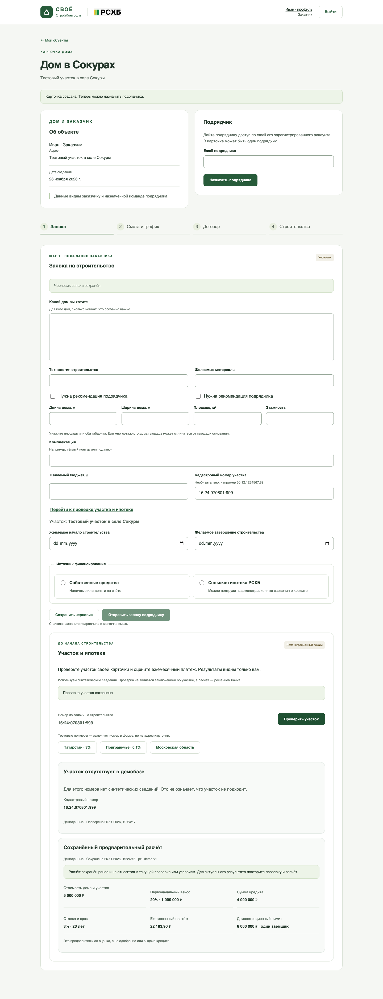

Другой положительный пример — `31:15:1203001:88`, демонстрационная ставка 0,1%. Кнопки примеров меняют только номер в несохранённой форме, не адрес карточки. Перед проверкой изменение нужно сохранить.

Ошибка номера и временная недоступность проверки

Для проверки нужен номер вида `16:24:070801:412`: две цифры региона, две цифры района, шесть или семь цифр квартала и от одной до семи цифр участка. Если сохранить `1:2:3:4` и нажать **Проверить участок**, сообщение укажет на поле с ошибкой. Остальные введённые сведения останутся на месте.

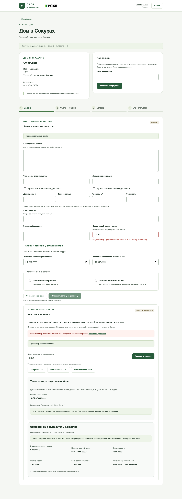

Если проверка временно недоступна, вы увидите сообщение об ошибке и **Повторить действие**. Последние сохранённые сведения останутся доступны. После восстановления сервиса повторите действие. Для воспроизведения этой ситуации на демонстрации организатор заранее выбирает сценарий по [инструкции запуска](development.md#демонстрационная-проверка-участка).

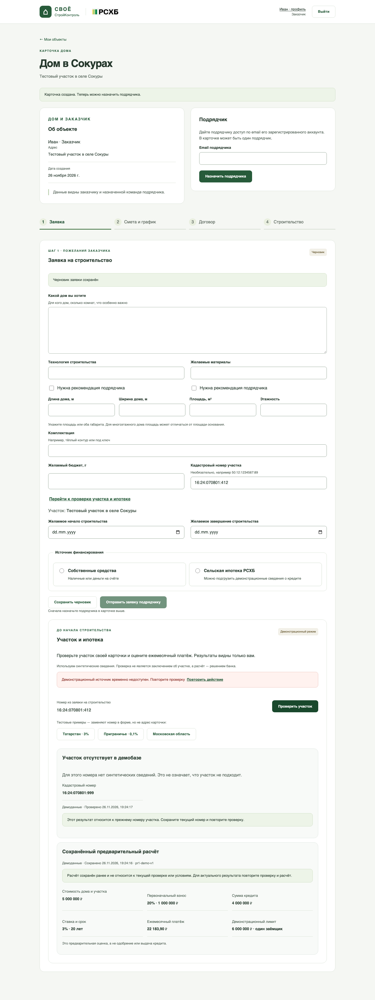

Результаты после отправки заявки подрядчику

Заполните остальные обязательные поля заявки по сценарию ниже, сохраните и дождитесь подтверждения. Назначьте подрядчика и отправьте заявку. В **Участок и ипотека** останутся сохранённые сведения, доступные для чтения. Новые проверки и расчёты больше не выполняются. Подрядчик и его команда этот блок не видят.

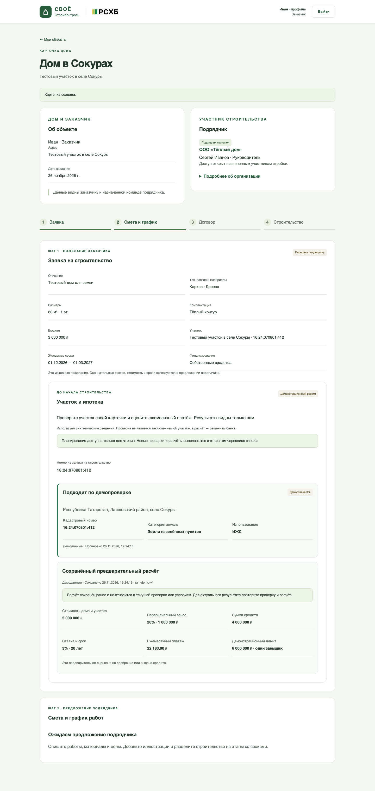

Тот же сценарий на телефоне

Откройте свою карточку на телефоне и повторите проверку участка. Номер, адрес, статус и тестовая ставка отображаются последовательно.

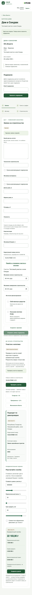

В калькуляторе задайте те же параметры и сохраните результат. Поля, ползунки и кнопка доступны с клавиатуры: Tab перемещает фокус, стрелки меняют значение ползунка, Enter нажимает выбранную кнопку.

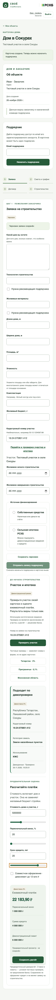

В демонстрационном видео после готового результата каждого действия выдерживайте спокойную паузу 4–6 секунд без кликов и прокрутки. Запись — без голоса, краткие пояснения внизу не перекрывают поля. [Вернуться к обзору возможностей](../README.md).

## 1. Участники и заявка

Зарегистрируйте аккаунты через **Зарегистрироваться**, указав имя и выбрав роли. Руководитель подрядчика заполняет организацию в **Моём профиле** перед назначением на новую стройку. После регистрации войдите отдельно. Под заказчиком создайте **Каркасный дом у озера**, адрес **с. Озёрное, участок 8**. В карточке **Подрядчик** назначьте builder@example.test: проверьте организацию и ИНН в предпросмотре и подтвердите назначение. До отправки заявки дом не виден подрядчику.

Заполните **Заявку на строительство**:

- Описание: «Одноэтажный дом для семьи, две спальни и кухня-гостиная».
- Технология: «Деревянный каркас»; материалы: «Камерная сушка, утеплитель 200 мм».
- Площадь: 80 м²; этажность: 1; комплектация: «Тёплый контур».
- Бюджет: 3 000 000 ₽; кадастровый номер: 50:12:1234567:89.
- Желаемые сроки: 01.12.2026 — 01.03.2027.
- Финансирование: **Сельская ипотека РСХБ**.

Сначала **Сохранить черновик**. Обновите страницу и проверьте введённые сведения.

## 2. Демонстрационная ипотека

Нажмите **Подключить Интернет-банк РСХБ**. В диалоге показан деморежим и перечень получаемых сведений. **Отмена** возвращает к заявке без импорта. Откройте снова, подтвердите **Показать демонстрационные сведения о кредите**, нажмите **Продолжить в деморежиме**. Появится **Одобрено · демоданные**, сумма, ставка, срок и даты решения. Это вымышленные сведения, не условия действующей банковской программы. Банк не вызывается, логин и пароль банка не нужны.

Нажмите **Отправить заявку подрядчику**. Выбор ипотеки без импорта тоже позволяет отправку. После отправки пожелания доступны только для чтения.

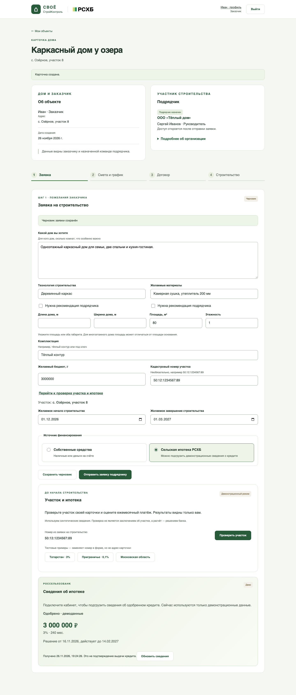

## 3. Предложение подрядчика

Выйдите, войдите подрядчиком и откройте дом из **Моих объектов**. Подробности кредита отсутствуют. Нажмите **Подготовить предложение**. Заполните **Смета: работы, материалы и цены**, общую стоимость 2 800 000 ₽ и исключения. Добавьте этап «Фундамент», вид «Фундамент», результат «Основание готово к монтажу каркаса», даты 01.12.2026 — 10.12.2026. Добавьте остальные этапы при необходимости; стрелки задают порядок.

В блоке **Изображения и планы** нажмите **Добавить изображения**, выберите JPEG/PNG/WebP и заполните **Подпись изображения**. Миниатюра появляется сразу, до загрузки; нажмите её для увеличенного просмотра и закройте кнопкой **Закрыть изображение** или Escape. **Выше**/**Ниже** меняют порядок, **Убрать из сметы** убирает картинку из черновика. После сохранения изображения доступны при повторном открытии. Заказчик видит их только в отправленной версии. Если загрузка не удалась, текст и выбранные файлы остаются в текущей форме для повтора; перезагрузка страницы потребует заново выбрать ещё не загруженные файлы. Старые внешние иллюстрации остаются с предупреждением. HTML сметы выводится как текст.

Нажмите **Сохранить предложение**, затем **Отправить предложение на согласование**. После изменения черновика отправка заблокирована до сохранения. Заказчик не видит незавершённый черновик подрядчика.

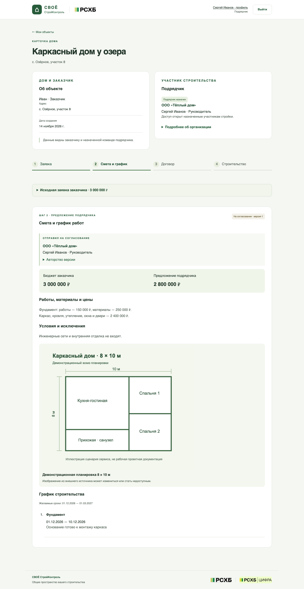

## 4. Уточнение и согласование сметы

Под заказчиком откройте дом. При появлении предложения исходная заявка свёрнута и доступна через **Исходная заявка заказчика**. Сравните желаемую и предложенную цену. Введите замечание «Отдельно указать стоимость террасы» и нажмите **Вернуть на уточнение**. Без комментария возврат недоступен.

Под подрядчиком нажмите **Подготовить новую версию**, исправьте текст, сохраните и отправьте. Под заказчиком выберите **Согласовать предложение**, проверьте версию и цену, затем **Подтвердить согласование**. Проверьте историю версий. План появился, но работы пока начать нельзя.

## 5. Договор подряда

Под подрядчиком нажмите **Подготовить договор**. Заполните **Текст договора подряда**: стороны и реквизиты, объект, состав работ, цена, порядок оплаты, сроки, порядок сдачи и приёмки, ответственность, изменение и расторжение. Сервис не генерирует юридические условия. Нажмите **Сохранить договор**, подтвердите **Условия проверены, отправить заказчику**, затем **Отправить договор на согласование**.

Под заказчиком верните договор с замечанием «Уточнить порядок оплаты по этапам». Подрядчик создаёт новую версию и повторяет отправку. Заказчик нажимает **Согласовать договор**, затем **Подтвердить согласование**. История предыдущего текста и замечания сохранена. В интерфейсе это согласование условий, не электронная подпись.

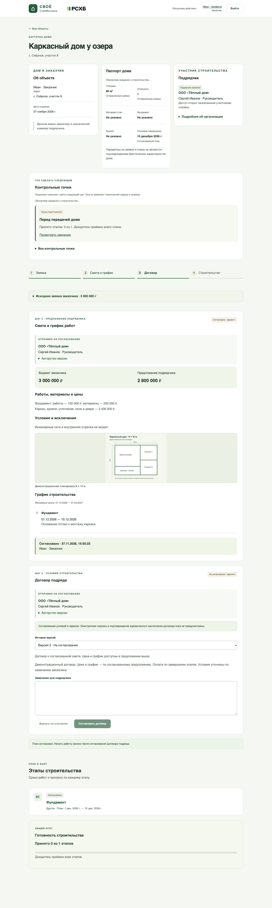

## 6. Выполнение и изоляция

Под подрядчиком откройте **Фундамент** и нажмите **Начать работы**. Появится **В работе** и сегодняшняя дата Москвы. Обновите страницу и нажмите **Завершить работы**. Обе стороны видят **Работы завершены** и фактические даты. Сроки и цена не изменяются напрямую после согласования.

Под посторонним заказчиком откройте сохранённую ссылку дома, версии сметы, договора или этапа: данные недоступны. Подрядчику недоступны подробности кредитного снимка.

Мобильный проход

Повторите сценарий при ширине 390 пикселей. Проверьте формы, банковский диалог, раскрытие исходной заявки, историю договора и начало этапа без горизонтальной прокрутки.

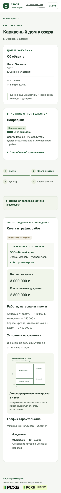

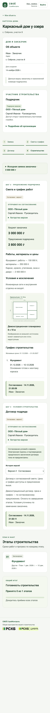

Прежние проекты продолжают работать со старым планом заказчика. Новые аккаунты и проекты Playwright создаются с уникальными email; снимки сняты с работающего приложения. [Проверки](testing.md).

## Журнал этапа и ответы

Роль подрядчика: из «Моих объектов» откройте согласованный дом и начатый этап. Нажмите
**Добавить запись**, оставьте тип **Ход работ**, заполните **Что сделано**. Через
**Добавить фото по ссылке** укажите HTTPS URL и **Что на фотографии**, затем
**Опубликовать**. Откройте фото, нажмите Escape: диалог закроется.

Создайте **Вопрос** «С какой стороны оставить проход к дому?» и запись **На согласование**
«Согласуйте размещение временного ограждения». Вопросы доступны во время выполнения этапа.

Роль заказчика: откройте тот же этап, ответьте в **Ваш ответ** и нажмите **Ответить**.
Для второй записи нажмите **Не согласовать**: без комментария поле получит подсказку.
Введите пояснение и повторите действие. Проверьте **Требуют ответа** — после всех ответов
появится **Всё обсуждено**. Перезагрузите страницу: история сохранится.

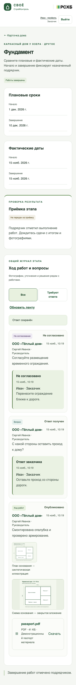

## Окончательный отказ и другой исполнитель

Для отдельной заявки с ещё не согласованной сметой роль заказчика выбирает
**Отклонить предложение**, указывает **Причину отказа** и нажимает **Подтвердить отказ**.
В блоке **Другой подрядчик** введите email второго зарегистрированного подрядчика, нажмите
**Выбрать другого подрядчика**, проверьте подтверждение и **Создать копию заявки**.
Новая карточка содержит редактируемые пожелания. После проверки отправьте их отдельно.
Первый подрядчик не видит копию, второй не видит историю исходного предложения.

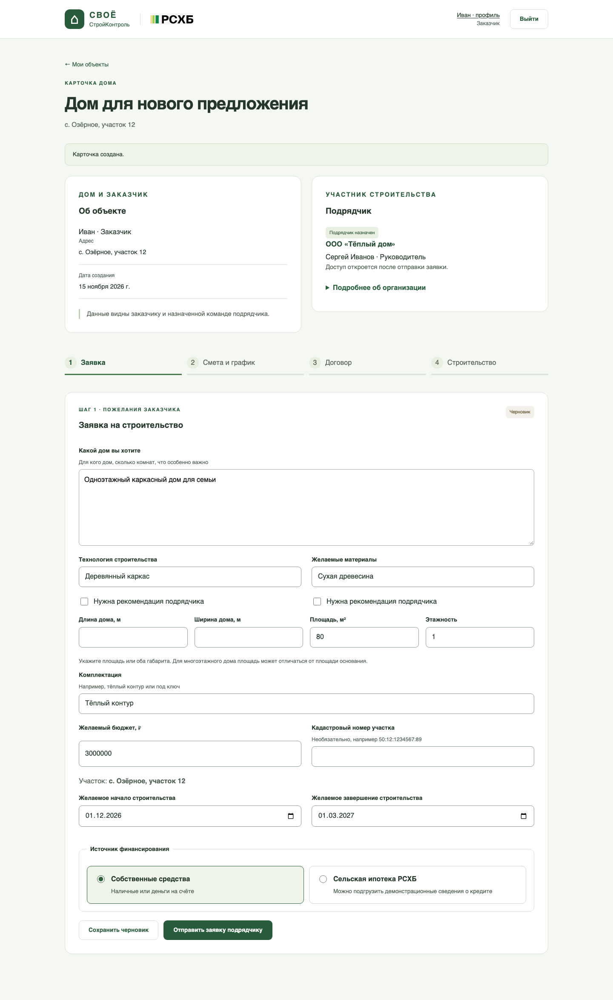

## Организация и личная команда

Руководитель Сергей Иванов открывает ссылку своего имени в шапке → **Мой профиль**, создаёт ООО «Тёплый дом» с полными реквизитами. Мария Соколова и Алексей Орлов заранее зарегистрированы как подрядчики с отдельными email.

1. В профиле руководитель раскрывает **Пригласить сотрудника**, приглашает Марию на должность «Юрист», Алексея — «Прораб».
2. Каждый сотрудник входит под своим аккаунтом, открывает профиль и нажимает **Принять приглашение**.
3. После назначения организации и отправки заявки руководитель открывает карточку дома → **Подробнее об организации** → **Настроить команду стройки**. Марии отмечает **Документы**, Алексею — **Работы**, сохраняет команду.
4. После согласования сметы Мария отправляет договор. Алексей видит отправленный договор, но не может его менять; после согласования договора начинает этап и публикует вопрос.
5. Заказчик Иван отвечает в журнале. Вопрос подписан «Алексей Орлов · Прораб», ответ — «Иван · Заказчик», рядом видно название организации.
6. Руководитель снимает доступ прораба. Повторное обращение из прежней сессии не открывает карточку. Исключение и повторное вступление в компанию не восстанавливает проектные назначения автоматически.

Снимки: [команда](screenshots/project-team-desktop.png), [автор договора](screenshots/contract-author-desktop.png), [мобильный журнал](screenshots/team-journal-mobile.png).

## Загрузка закрытых фото и документов

Под прорабом откройте начатый этап → **Добавить запись**, заполните **Что сделано**. В **Добавить фото или PDF** выберите PNG/JPEG/WebP и PDF. Укажите **Подпись загруженной фотографии**, при необходимости **Пояснение к документу**. Нажмите **Опубликовать**. В ленте появляется одна запись с фото и ссылкой на PDF. Под заказчиком откройте фото и скачайте PDF; постороннему участнику содержимое недоступно. Изображения по внешней ссылке остаются иллюстрациями, а не закрытыми загрузками.

## Сдача, банк и завершение

Продолжите предыдущий сценарий в том же этапе. Используйте синтетические аккаунты Ивана и подрядчика, загруженную фотографию в журнале и ипотечный источник финансирования.

1. Подрядчик завершает работы, нажимает «Передать на приёмку», описывает результат и выбирает запись с настоящим загруженным фото.
2. Иван открывает этап, возвращает с замечанием «Добавьте крупный план усиления углов». Подрядчик публикует новое подтверждение, нажимает «Сдать повторно» и выбирает новую запись.
3. Иван принимает этап; история обоих циклов остаётся в карточке.
4. Иван открывает «Проверить и отправить» в блоке банка, изучает состав и явно отправляет. При отсутствии кредитного дела сначала подключает синтетическое дело с согласием.
5. В Compose по умолчанию демо-банк запрашивает дополнение первой версии. Иван видит «Нужно дополнить», добавляет пояснение/PDF и отправляет новую версию. Она получает «Принято демо-банком».
6. После приёмки всех этапов Иван открывает карточку дома и подтверждает завершение. Банковское дополнение можно отправить как до, так и после этого действия.
7. Повторите с собственными средствами: банковского блока нет, завершение зависит только от приёмки этапов.

Для полного воспроизводимого прохода выполните Playwright `preparation.spec.ts`; данные и PNG создаются автоматически. Сценарий демонстрации сокращён до одного этапа, чтобы показать весь процесс, а не имитировать фактическую сдачу настоящего дома.

PDF-презентация для личного просмотра сохраняется в `output/pdf/`; она использует реальные PNG готовых экранов и короткие пояснения без озвучки. В текущей версии 25 страниц: загрузка изображений сметы и увеличенный просмотр показаны отдельно, подготовка заявки/сметы/договора отделена от выполнения и приёмки строительных этапов, а банковское подтверждение показано отдельным процессом. Знаки РСХБ и «РСХБ Цифра» присутствуют на каждой странице.
