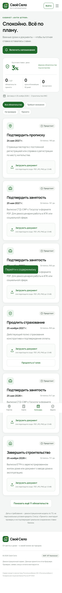

# Своё Село

Помогает проверить демонстрационный участок, спланировать бюджет дома, следить за обязательствами по ипотеке и рассчитать страховку.

Запуск: откройте `Запустить.command`, затем http://127.0.0.1:5173.

React + TypeScript + Vite, Tailwind CSS, Lucide. Данные сохраняются в localStorage текущего браузера. Исходный СтройКонтроль остаётся отдельным приложением на порту 8088.

## Возможности

- Проверка трёх демонстрационных кадастровых номеров и ипотечный калькулятор.
- Смета из шести этапов: план, факт, шаблоны, экспорт CSV/JSON.
- Календарь обязательств с загрузкой документов и демонстрационным одобрением.
- Расчёт страховки, демонстрационная покупка и обновление календаря.

Вход: любой корректный телефон, код **1234**. Кнопка Госуслуг также работает в демонстрационном режиме. После входа гостевые данные сохраняются, отложенное действие продолжается.

Это автономный MVP: заявки, проверка участка, оплата и проверка документов демонстрационные, внешние сервисы не вызываются. Документы до 1,5 МБ сохраняются в браузере; очистка данных браузера удалит их. Не используйте реальные персональные документы.

[Запуск и диагностика](docs/development.md) · [Сценарий демонстрации](docs/demo.md) · [Проверки](docs/testing.md)

Фото главной: [Unsplash](https://images.unsplash.com/photo-1600585154340-be6161a56a0c).
